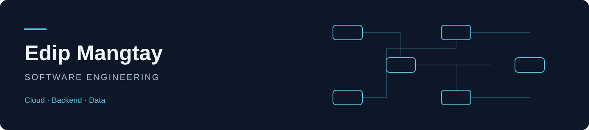

# Edip Mangtay

**Software engineering student building toward cloud, backend and data engineering.**

I am in the final year of the English-language Software Engineering program at **Istinye University**, with expected graduation in **June 2027**. My projects span Python services, simulation, relational data, machine learning and mobile applications.

My current focus is learning how to make systems easier to reproduce, test and operate. I am following the **Google Cloud Associate Cloud Engineer learning path** and **DataCamp's Python development curriculum**. Cloud certification is a learning goal.

## Selected engineering work

**[WareTwin · warehouse coordination laboratory](https://github.com/EdipMangtay/WareHouse)**  
An active warehouse simulation project with a Python simulation core, FastAPI research sessions, a React/TypeScript interface and a headless experiment runner. It explores zone coordination, shared conveyors, scheduling and congestion. **In development.**

**[EdgeScope · backend and analytics](https://github.com/EdipMangtay/Trading_Journal)**  
A trading journal application with FastAPI, SQLAlchemy, PostgreSQL and a Next.js interface. Explore the API, migrations and tests for user isolation, account rules and performance calculations.

**[Hip Implant Surrogate ML · team project](https://github.com/EdipMangtay/ENS_Project)**  
A Flask interface and inference pipeline for models trained on engineering simulation data. **My documented contribution:** Flask dashboard, prediction interface and integration. The repository credits the software and mechanical engineering teams. **Academic research prototype.**

**[Campus Lost & Found · Flutter and Firebase](https://github.com/EdipMangtay/Lost_Item_App)**  
A campus application with Firebase authentication, Firestore repositories, item photos, claims and chat. The feature-based Flutter structure uses Riverpod and generated data models. **Academic application; deployment hardening remains.**

**[Liquidity Edge · desktop application](https://github.com/EdipMangtay/Journal)**  
An offline trading journal with a native Swift macOS application and an Electron Windows application. The repository includes persistence, analytics, backup handling, tests and preview releases.

**[Concurrent Java Chat · networking fundamentals](https://github.com/EdipMangtay/Java_midterm)**  
A TCP client/server application using Swing, threads and a shared bounded request buffer. A focused example of producer–consumer coordination and request processing.

## Tools used in my projects

- **Python and data:** FastAPI, Flask, pandas, NumPy, scikit-learn and pytest.
- **Backend and storage:** SQL, SQLAlchemy, PostgreSQL, SQLite and C#/.NET.
- **Applications:** Flutter/Dart, Firebase, React and TypeScript.
- **Engineering workflow:** Git, GitHub Actions and Docker configurations.

These reflect project experience; cloud operations and MLOps are the next areas I am developing.

## Explore my work

Start with **WareTwin** for simulation and system design, **EdgeScope** for backend engineering, and **Hip Implant Surrogate ML** for a team research application. Project READMEs describe setup, implementation boundaries and current limitations.

For foundational notebooks and exercises, see **[DataScience](https://github.com/EdipMangtay/DataScience)**.

[LinkedIn](https://www.linkedin.com/in/ali-edip-mangtay-7b6b5a223/)

